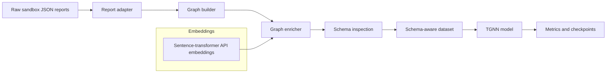
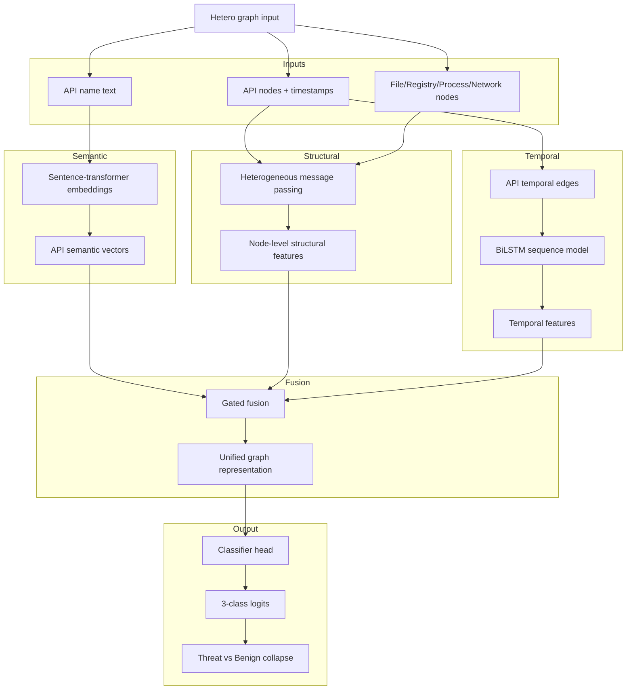

# Threat Detection TGNN

Temporal Graph Neural Network (TGNN) pipeline for dynamic threat detection. The project builds schema-aware heterogeneous graphs from sandbox execution reports, enriches API nodes with LLM embeddings, and trains a temporal-structural model for behavioral classification. Threat categories can include ransomware, trojans, and other malicious families, while the final operational decision focuses on threat vs benign.

## What the model does

The model learns behavioral patterns from execution traces by combining three signals:

- Structural: heterogeneous graph message passing over API, process, file, registry, and network nodes.
- Temporal: sequence modeling over API call order and timing using temporal edges and an LSTM backbone.
- Semantic: sentence-transformer embeddings for API names to reduce brittleness to API obfuscation.

Output is a 3-class prediction per report: Threat, Benign, or Other Malicious (family-specific). For the final operational decision, results are also collapsed into Threat vs Benign. Training uses schema-aware validation to keep feature dimensions consistent across cached graph sources.

## Threat vs Benign decision

The training loop reports both 3-class metrics and a derived 2-class view:

- Threat = Ransomware + Trojan + Other Malicious
- Benign = Benign

This mirrors the final usage, where the model is judged on its ability to separate malicious behavior from benign activity.

## Architecture



If you want a visual snapshot of the current graph representation, see [graph_visualization.png](graph_visualization.png).

## End-to-end flow

1) Raw sandbox JSON reports are adapted into a canonical schema.
2) Heterogeneous graphs are built with typed nodes and temporal edges.
3) API nodes are enriched with sentence-transformer embeddings.
4) Schema inspection records stable dims and types for training.
5) Dataset loaders normalize graph tensors against the active schema.
6) TGNN trains and writes checkpoints, metrics, and logs.

## Model internals



## Quick start

### 1) Environment

- Create and activate a virtual environment.
- Install dependencies.

```bash
python3 -m venv .venv
source .venv/bin/activate
pip install -r requirements.txt
```

### 2) Data preparation

This project expects preprocessed sandbox reports and split files.

- Raw reports: data/new_reports (for the v2 pipeline)
- Labels: data/new_reports_labels.csv
- Metadata: extracted_metadata_appended.csv or data/extracted_metadata_appended.csv
- Splits: data/splits

If you need to (re)create splits from metadata, update the split script to match
your metadata paths and categories first. The current script imports settings that
are not defined in config.py, so it will fail unless you align those values.

### 3) Build graphs

You have two paths, depending on the data source you want to use.

#### Option A: v2 pipeline (recommended for new raw reports)

```bash
python3 -m pipeline_v2.run_pipeline_v2
```

This writes enriched graphs to cache/cuckoo_enriched_v2 and schema files to results/schema/cuckoo_enriched_v2.

After it finishes, update the graph source in config.py if you want to train on v2 data:

- Set ACTIVE_GRAPH_SOURCE to cuckoo_enriched_v2

#### Option B: legacy enrichment (for existing cache/train|val|test)

```bash
python3 -m graph_construction.llm_setup
python3 -m graph_construction.enrich_node_features
```

This generates cache/api_embeddings.pkl and writes enriched graphs to cache/enriched.

### 4) Train

```bash
python3 -m models.train
```

This runs the training module directly, which auto-refreshes schema if needed and writes outputs under results/ (checkpoints, logs, metrics).

## Project structure

- baseline_models/: classical ML baselines and robustness checks.
- baselines/: saved baseline results and feature info.
- baselines_custom_eval/: baseline evaluation artifacts for custom splits.
- benign_operation_report/: benign-only operational summaries.
- benign_val.csv/: split summaries for benign validation.
- cache/: cached graphs and enriched graph sources (including v2 caches).
- checkpoints/: model checkpoint storage (legacy).
- data/: raw data, metadata, labels, and split files.
- data_processing/: scripts for split creation and data preprocessing.
- embeddings/: embedding-related artifacts.
- evaluation/: evaluation helpers and analysis scripts.
- graph_construction/: graph creation, enrichment, and dataset utilities.
- logs/: training or pipeline logs (legacy).
- metrics/: metric outputs (legacy).
- miscle/: small utilities and debug helpers.
- models/: TGNN architecture and training logic.
- pipeline_v2/: end-to-end raw-report to enriched-graph pipeline.
- results/: checkpoints, metrics, logs, schemas, and analysis outputs.
- robustness_compare/: robustness experiments.
- robustness_compare_dual/: robustness experiments (dual setting).
- scripts/: standalone utilities and experiments.
- utils/: schema management, validation, and helper utilities.
- validation_dataset/: validation datasets and helper files.

## Key files

- models/train.py: primary training entry point.
- main.py: thin wrapper that runs models/train.py.
- config.py: global configuration for paths, schemas, and training.
- requirements.txt: Python dependencies.
- report.md: thesis-style project overview and objectives.

## Outputs

- results/checkpoints/: best model checkpoints.
- results/metrics/: metric summaries.
- results/logs/: training logs.
- results/schema/: schema.json and summaries per graph source.

## Notes and troubleshooting

- Schema is auto-refreshed on training if cache graphs changed.
- On macOS, set NUM_WORKERS = 0 in config.py if DataLoader multiprocessing is unstable.
- If you change graph sources, ensure ACTIVE_GRAPH_SOURCE and results/schema are aligned.

## Citation

If you use this project in academic work, please cite the associated thesis and the referenced papers in report.md.
